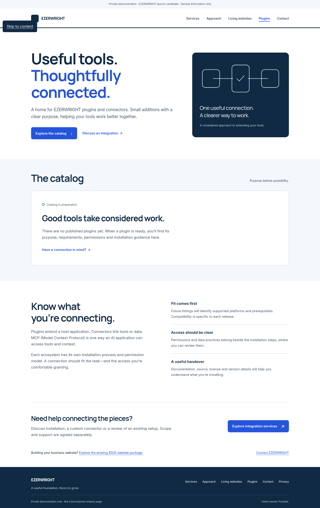
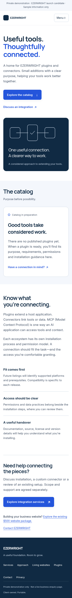
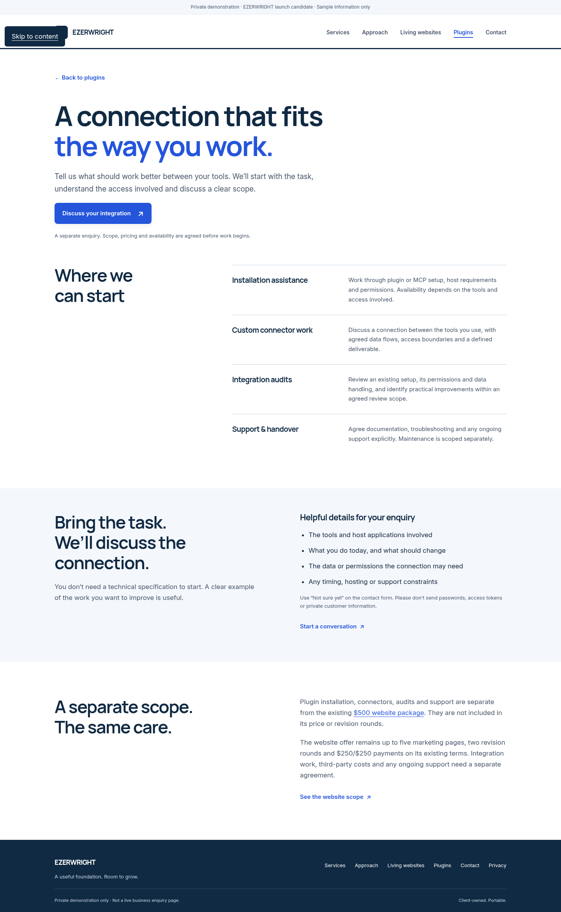
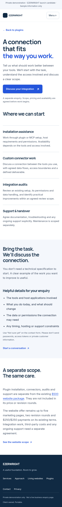

# EZERWRIGHT Plugins review

Implemented on `feat/plugins-catalog`, based on `c0e81e7`. No merge or deployment authorized or performed.

## Verification

- Node 24.19.0 satisfies the package engine (`>=22.19.0`).
- `npm ci --ignore-scripts`: passed, lockfile unchanged.
- `npm run qa`: **59 passed, 0 failed, 0 skipped**. Includes the existing contact, rate-limit, Turnstile, recipient, release, portability and commercial-contract tests.
- New checks cover empty/published/draft manifests, invalid slugs/URLs/dates, required disclosure fields, duplicate and reserved slugs, real Astro detail generation, escaped hostile text, production canonical/indexing/CSP/redirects and client-template route exclusion. Synthetic build fixtures are temporary and deleted.
- Existing static SEO/link/budget and axe checks now include plugin routes. No production dependencies or additional JavaScript introduced.
- Chromium with axe-core 4.11.0: both pages at widths 320, 390, 768, 1024 and 1440; **zero violations**, including rendered color contrast, **zero horizontal overflow**, **zero page exceptions**. Skip-link focus, mobile menu/Escape, and reduced-motion checks pass. No-JavaScript navigation is visible and wraps at 320px. See `browser-checks.json`.
- `git diff --check`: passed.

## Impeccable design review and refinement

Method: manual, single-context review using the installed Impeccable skill's new-work, craft-floor, critique and accessibility-audit guidance. **This is a degraded review, not the formal independent dual-agent critique.** The installed skill is accessible, but its executable launcher and detector are absent (`No such file or directory`). Context loading and a detector command were attempted. No detector findings or live overlay are claimed. PRODUCT.md, DESIGN.md, existing hooks and project Impeccable artifacts were absent; the existing code, fonts, tokens and rendered pages supplied design context. No plugin installation/configuration changes were made.

The established design is preserved: Manrope headings, Inter body, navy `#102A43`, blue `#2455DB`, pale `#F4F7FC`, shared header/footer, container widths and button language. The catalog adds an editorial split composition and a restrained connection diagram; services use readable rows rather than a repeated marketing-card grid. There are no fabricated products, marketplace affiliations, pricing, testimonials or statistics.

Review findings resolved in one batch:
- Desktop menu button duplicated visible navigation: hide it above the mobile breakpoint on agency surfaces.
- New navigation item risks crowding tablet and no-JavaScript mobile layouts: agency-only wrapping rules apply across the agency, not only plugin pages.
- Footer focus outline blended into navy: use white for agency-footer focus.
- Plugin detail/catalog text can contain very long strings: enable wrapping within plugin surfaces.

Final confirmation: browser/axe checks and full QA passed after fixes. Typography, empty-state clarity, touch affordances and disclosure hierarchy were visually inspected in desktop/mobile captures. The new content is always visible; motion is limited to existing button feedback and directional link feedback with reduced-motion support. Real screen-reader testing, live Turnstile/mail delivery and Cloudflare runtime verification were not performed. Automated axe results do not establish complete WCAG conformance.

### Screenshots

Demo-mode captures intentionally retain the existing demonstration notice and noindex policy.

| Catalog desktop | Catalog mobile |
| --- | --- |
|  |  |

| Services desktop | Services mobile |
| --- | --- |
|  |  |

## Review and deployment checklist (not executed)

- [ ] Review branch, screenshots, empty catalog and separately scoped service copy.
- [ ] Confirm publication remains a separate owner decision; no plugins are currently published.
- [ ] Review production build variables and existing approved privacy/Turnstile setup; use real secrets only through the existing protected release process.
- [ ] Obtain explicit authorization before merging or deploying. This change grants neither.
- [ ] After an authorized release, verify canonical/robots/sitemap/headers/navigation/contact paths using the existing release procedure.

## Rollback

Revert the feature commit and rebuild through the existing reviewed release process. No database, secret, Worker binding, recipient, API whitelist, DNS or marketplace state changed. Restoring an earlier static artifact should follow the existing owner-controlled release gates. No rollback deployment was executed.
